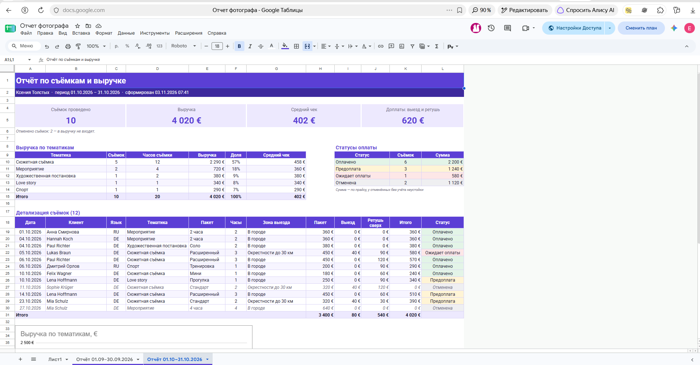
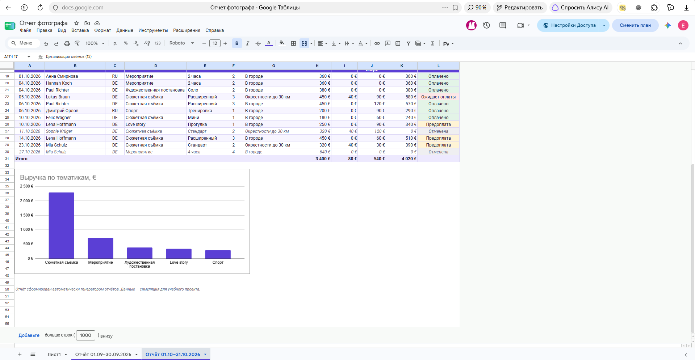

# Отчёт по ДЗ VPh02 — автоматический отчёт в Google Sheets

## Задание

Создать проект Google Cloud, включить Google Sheets API, настроить сервисный аккаунт и дать ему доступ к таблице. Разработать Python-модуль с CRUD-операциями для Google Sheets и приложение Tkinter, которое создаёт случайный отчёт и записывает его в таблицу с оформлением.

## Что сделано

- Разработан ООП-модуль `google_sheets.py`: чтение и запись ячеек и диапазонов, добавление и удаление строк, работа с листами, форматирование, объединение ячеек, границы, ширина столбцов и диаграммы.
- `data_generator.py` формирует синтетические записи о съёмках фотографа по выбранному периоду и тематикам.
- `report_builder.py` рассчитывает показатели и создаёт структуру оформленного отчёта; `report_generator.py` предоставляет окно Tkinter и HTML-предпросмотр.
- Настроен сервисный аккаунт Google Cloud, включён доступ к таблице. JSON-ключ хранится локально и не включён в репозиторий.
- В существующую таблицу «Отчёт фотографа» добавлен лист «Отчёт 01.10–31.10.2026». Он содержит сводку, детализацию, статусы, формулы, оформление и столбчатую диаграмму.

## Проверки и результат

- Автотесты на поддельном Google API: **43 прошли**.
- Реальное подключение к Google Sheets API проверено сервисным аккаунтом. Новый лист создан, затем прочитан обратно: период, число активных съёмок и сумма совпали с расчётами приложения.
- Для реального отчёта использовано 12 синтетических записей; 10 активных съёмок, итоговая сумма — **4 020 €**. Google подтвердил форматирование скрытой сетки и наличие диаграммы.
- Представлены скриншоты итоговой таблицы и диаграммы в `docs/evidence/`.
- Код окна Tkinter запускается. Запись проверена через те же функции генератора и Google Sheets API, которые вызывает приложение; нажатие кнопки генерации в самом окне отдельно не автоматизировалось.

### Скриншоты результата

Общий вид октябрьского отчёта:

Диаграмма выручки и продолжение детализации:

## Файлы и запуск

Основной код: `google_sheets.py`, `data_generator.py`, `report_builder.py`, `report_generator.py`.

Инструкция по установке, настройке `.env` и запуску: [README.md](README.md). Для подключения нужен собственный JSON-ключ сервисного аккаунта; в репозитории ключа нет. `.env` также не публикуется.

## Ограничения и выводы

Это симулятор для учебного задания. Имена клиентов, заявки и финансовые суммы в отчёте синтетические. Данные не представляют реальную клиентскую базу.

В отчёте «выручка» означает стоимость активных съёмок, в том числе ожидающих оплату; для реальной CRM следует отдельно считать начисления, фактически полученные платежи и задолженность. Отменённые съёмки исключаются из общей суммы, а в таблице статусов показана их расчётная стоимость по прайсу.

## Материалы

- Код проекта: https://github.com/JaneEva08/photographer-report-generator.
- Таблица и скриншоты показывают учебный результат; доступ к исходной Google Таблице остаётся ограниченным её настройками доступа.
